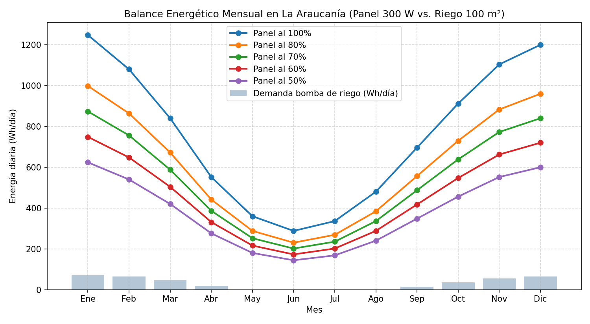
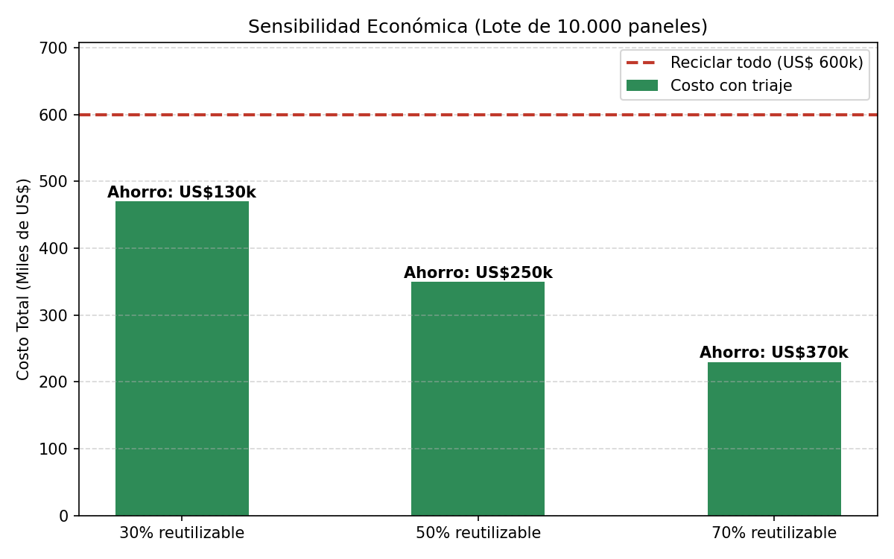

# Resultados de la Simulación en Python

## 1. Balance Energético e Hídrico Mes a Mes (La Araucanía)

| Mes | HSP (h) | Agua (L/día) | Bombeo (h/día) | Demanda (Wh/día) | Panel 100% (Wh) | Panel 80% (Wh) | Panel 70% (Wh) | Panel 60% (Wh) | Panel 50% (Wh) | % Uso (al 50%) |
| --- | --- | --- | --- | --- | --- | --- | --- | --- | --- | --- |
| Ene | 5.2 | 480 | 1.75 | 69.8 | 1248 | 998 | 874 | 749 | 624 | 11.2% |
| Feb | 4.5 | 450 | 1.64 | 65.5 | 1080 | 864 | 756 | 648 | 540 | 12.1% |
| Mar | 3.5 | 320 | 1.16 | 46.5 | 840 | 672 | 588 | 504 | 420 | 11.1% |
| Abr | 2.3 | 120 | 0.44 | 17.5 | 552 | 442 | 386 | 331 | 276 | 6.3% |
| May | 1.5 | 0 | 0.00 | 0.0 | 360 | 288 | 252 | 216 | 180 | 0.0% |
| Jun | 1.2 | 0 | 0.00 | 0.0 | 288 | 230 | 202 | 173 | 144 | 0.0% |
| Jul | 1.4 | 0 | 0.00 | 0.0 | 336 | 269 | 235 | 202 | 168 | 0.0% |
| Ago | 2.0 | 0 | 0.00 | 0.0 | 480 | 384 | 336 | 288 | 240 | 0.0% |
| Sep | 2.9 | 100 | 0.36 | 14.5 | 696 | 557 | 487 | 418 | 348 | 4.2% |
| Oct | 3.8 | 250 | 0.91 | 36.4 | 912 | 730 | 638 | 547 | 456 | 8.0% |
| Nov | 4.6 | 380 | 1.38 | 55.3 | 1104 | 883 | 773 | 662 | 552 | 10.0% |
| Dic | 5.0 | 450 | 1.64 | 65.5 | 1200 | 960 | 840 | 720 | 600 | 10.9% |

## 2. Sensibilidad Económica del Triaje (Lote de 10.000 paneles)

- **Punto de equilibrio (break-even):** Basta con que el **8.3%** del lote sea reutilizable para que el triaje se pague solo frente al reciclaje.

| % Reutilizable | Paneles Reutilizados | Paneles a Reciclar | Costo Reciclar Todo (US$) | Costo con Triaje (US$) | Ahorro Neto (US$) | Ahorro (%) |
| --- | --- | --- | --- | --- | --- | --- |
| 30% | 3000 | 7000 | 600,000 | 470,000 | 130,000 | 21.7% |
| 50% | 5000 | 5000 | 600,000 | 350,000 | 250,000 | 41.7% |
| 70% | 7000 | 3000 | 600,000 | 230,000 | 370,000 | 61.7% |

## 3. Validación de la Razón de Diagnóstico (Isc / Isc_ref)

| Salud Real | Irradiancia (W/m²) | Isc Panel (A) | Isc Ref (A) | Salud Estimada (S_Isc) | Error (puntos %) | Clasificación |
| --- | --- | --- | --- | --- | --- | --- |
| 85% | 400 | 3.28 | 0.0591 | 87.6% | 2.59 | Clase A (Reventa) |
| 85% | 700 | 5.74 | 0.1034 | 87.6% | 2.59 | Clase A (Reventa) |
| 85% | 1000 | 8.20 | 0.1477 | 87.6% | 2.59 | Clase A (Reventa) |
| 60% | 400 | 2.31 | 0.0591 | 61.8% | 1.83 | Clase B (Segunda vida) |
| 60% | 700 | 4.05 | 0.1034 | 61.8% | 1.83 | Clase B (Segunda vida) |
| 60% | 1000 | 5.79 | 0.1477 | 61.8% | 1.83 | Clase B (Segunda vida) |
| 45% | 400 | 1.74 | 0.0591 | 46.4% | 1.37 | Clase D (Reciclaje) |
| 45% | 700 | 3.04 | 0.1034 | 46.4% | 1.37 | Clase D (Reciclaje) |
| 45% | 1000 | 4.34 | 0.1477 | 46.4% | 1.37 | Clase D (Reciclaje) |
